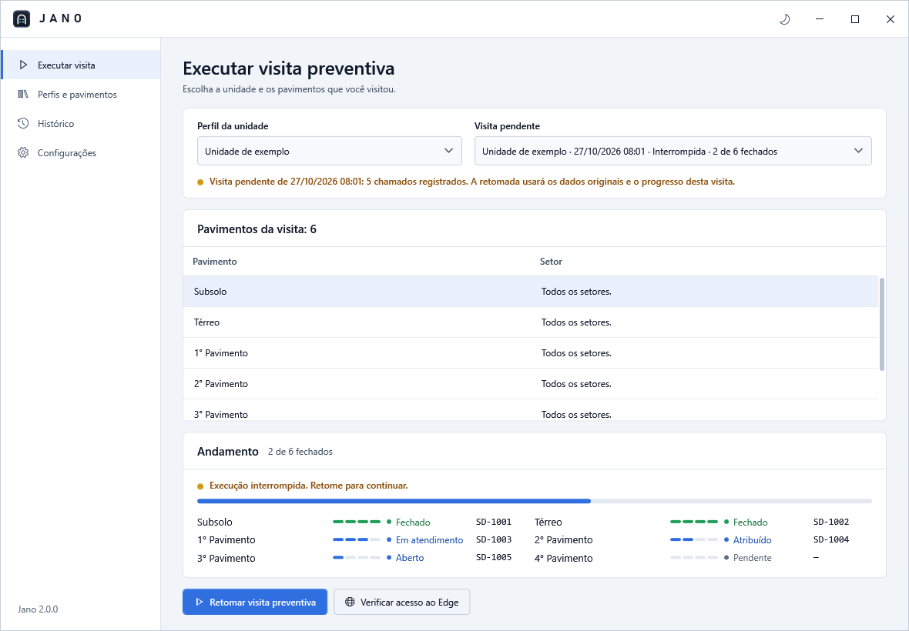
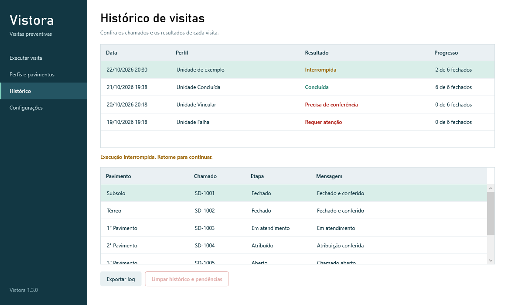

# Documentação do Jano

Automação de chamados de visitas preventivas no Jira, com execução pelo Microsoft Edge. O Jano se chamava Vistora até a versão 1.4. Esta documentação também está disponível em PDF: [Documentação (PDF)](<Documentação (PDF).pdf>).

## Sumário

1. [Visão geral](#1-visão-geral)
2. [Instalação](#2-instalação)
3. [Configurar o Jira](#3-configurar-o-jira)
4. [Cadastrar uma unidade](#4-cadastrar-uma-unidade)
5. [Verificar o acesso ao Edge](#5-verificar-o-acesso-ao-edge)
6. [Executar uma visita](#6-executar-uma-visita)
7. [Consultar o histórico](#7-consultar-o-histórico)
8. [Parar e retomar](#8-parar-e-retomar)
9. [Exportar um diagnóstico](#9-exportar-um-diagnóstico)
10. [Limpar o histórico](#10-limpar-o-histórico)
11. [Dados locais](#11-dados-locais)
12. [Problemas comuns](#12-problemas-comuns)

---

## 1. Visão geral

O Jano é um aplicativo para Windows que registra visitas preventivas no Jira por unidade e pavimento. Para cada pavimento selecionado, ele abre um chamado, atribui ao técnico conectado, inicia o atendimento e envia o fechamento com a resolução e o comentário público. Todo o trabalho acontece pela própria interface do Jira, em uma janela visível do Microsoft Edge, sem usar a API.

O progresso é salvo no computador antes e depois de cada ação. Assim, uma visita interrompida pode ser retomada sem duplicar chamados.

### Principais funções

| Função | O que faz |
|---|---|
| Perfis de unidades | Cadastra solicitante, unidade, pavimentos, resoluções e anexos opcionais. |
| Automação no Edge | Preenche os formulários e executa as transições do chamado pela interface do Jira. |
| Acompanhamento | Mostra o número do chamado e as etapas de cada pavimento durante a execução. |
| Retomada de pendências | Recupera os dados originais da visita e confere os chamados antes de continuar. Visitas sem chamados podem ser descartadas. |
| Conferência de resultados | Verifica responsável, status, resolução, comentário público e equipe no fechamento. |
| Histórico e diagnóstico | Reúne os resultados das visitas e exporta um ZIP de registros para análise. |
| Tema claro e escuro | Troca na hora, pela barra de título ou pelas Configurações, e fica salvo no computador. |

### Fluxo de uso resumido

1. Configure os endereços, a equipe e o fluxo do Jira em **Configurações** (seção 3).
2. Cadastre a unidade e seus pavimentos em **Perfis e pavimentos** (seção 4).
3. Verifique o acesso ao Edge e faça login no Jira (seção 5).
4. Escolha o perfil, marque os pavimentos e execute a visita (seção 6).
5. Consulte o resultado em **Histórico** (seção 7).

---

## 2. Instalação

### Requisitos

- Windows x64 com o Microsoft Edge instalado.
- Conta no Jira com permissão para abrir, atribuir, iniciar e fechar os chamados do fluxo de visita preventiva.
- Para compilar a partir do código: SDK .NET 10 (ou o script `Bootstrap.ps1`, que o instala na pasta do projeto).

### Usando o pacote da versão

Extraia o ZIP da distribuição (`Jano-<versão>-Windows-x64.zip`) para uma pasta e abra `Jano.exe`. Conserve todos os arquivos do pacote, incluindo as pastas `.playwright`, `assets` e `guides`. O aplicativo usa o Microsoft Edge instalado no computador.

Quem usava o Vistora pode extrair a 2.0 em outra pasta e abrir o `Jano.exe`: os dados continuam em `%LOCALAPPDATA%\Vistora` (seção 11), então perfis, configurações, a sessão do Edge e as visitas pendentes são aproveitados. Atalhos antigos apontam para o `Vistora.exe` e precisam ser recriados.

### Compilando a partir do código

Clone o repositório, prepare o SDK (se necessário) e compile:

```powershell
git clone https://github.com/brendonpereiradev/Jano.git
cd Jano
.\scripts\Bootstrap.ps1
.\scripts\Build.ps1
```

Para iniciar o aplicativo compilado:

```powershell
. .\scripts\Common.ps1
& (Get-VistoraDotnet) run --project .\src\Vistora.Desktop -c Release --no-build
```

| Script | Uso |
|---|---|
| `.\scripts\Bootstrap.ps1` | Instala o SDK localmente em `.tools/dotnet`. |
| `.\scripts\Build.ps1` | Compila a solução em Release. |
| `.\scripts\Test.ps1` | Executa os testes; `-SkipBrowser` dispensa os testes que abrem o Edge e `-BrowserOnly` roda só esses. |
| `.\scripts\Publish.ps1` | Gera a aplicação com runtime incluído e o ZIP da versão em `output/release/`. |
| `python scripts\New-Documentation.py` | Gera esta documentação em PDF a partir do Markdown (requer o ReportLab). |

---

## 3. Configurar o Jira

Tudo o que depende do Jira da sua equipe fica em **Configurações**. Ajuste os valores e clique em **Salvar configurações**, no fim da página.

Os endereços que vêm preenchidos na primeira abertura são fictícios. Preencha os do seu ambiente:

| Campo | Endereço esperado |
|---|---|
| Endereço do Jira | Endereço principal do servidor. |
| Endereço do formulário de visita preventiva | Página usada para abrir a solicitação no portal. |
| Endereço da fila de atendimento | Fila de chamados do ambiente. |
| Caminho do chamado | Caminho do chamado a partir do endereço do Jira. |

Os três endereços devem usar HTTPS e pertencer ao mesmo servidor. No caminho do chamado, `{key}` é o número completo, como `SD-123`, e `{project}` é o prefixo, como `SD`. O caminho deve começar com `/` e conter `{key}`.

> **Atenção.** A conta do técnico precisa ter acesso ao formulário e às ações de atribuição, atendimento e fechamento. O fluxo da automação deve corresponder aos campos e às transições disponíveis nesse Jira.

### Equipe e fluxo de atendimento

Numa instalação nova, estes campos vêm em branco, porque dependem do Jira de cada equipe. Enquanto algum estiver vazio, o Jano não abre chamados e indica no painel de status o que falta preencher. Escreva os nomes como aparecem no Jira.

| Campo | Exemplo |
|---|---|
| Equipe de fechamento | `Equipe de Campo` |
| Tipo de solicitação | `Visita preventiva` |
| Status aguardando atendimento | `Aguardando atendimento` |
| Transição para iniciar o atendimento | `Iniciar atendimento` |
| Status em atendimento | `Em atendimento` |
| Transição para fechar | `Fechar chamado` |
| Status de chamado fechado | `Fechado`, `Closed`, `Concluído`, `Concluido` (um por linha; vem preenchido) |
| Caminho do chamado | `/jira/servicedesk/projects/{project}/queues/issue/{key}` (vem preenchido, no formato do Jira Service Management) |

Quem atualiza de uma versão até a 2.1.1 mantém os valores que já usava. Um campo que não estava gravado nas configurações recebe o valor que era o padrão dessas versões.

### Campos do formulário

O Jano encontra os campos do formulário e do chamado pelo rótulo exibido no Jira. Os rótulos padrão são genéricos. Confira cada um com o formulário da sua equipe e informe o nome que ele usa. Um campo em branco volta ao rótulo padrão.

Quando o formulário e a página do chamado mostram o mesmo campo com nomes diferentes, informe os dois separados por `|`, como `Setor | Local`.

Quem atualiza de uma versão até a 2.2.1 mantém os rótulos que já usava. Um rótulo que não estava gravado nas configurações recebe o que era o padrão dessas versões e aparece preenchido em Configurações.

| Campo | Rótulo padrão |
|---|---|
| Solicitante (em nome de) | `Solicitante` |
| Título | `Título` |
| Ramal | `Ramal` |
| Nome completo | `Nome completo` |
| Unidade | `Unidade` |
| Pavimento | `Andar` |
| Setor | `Setor` |
| Sala | `Sala` |
| Telefone | `Telefone` |
| Descrição | `Descrição` |
| Botão de envio do formulário | `Enviar` |
| Resolução | `Resolução do atendimento` |
| Equipe de fechamento | `Equipe` |

Os nomes que o próprio Jira exibe, como Responsável, Relator, Assign to me e Reply to customer, são reconhecidos em português e em inglês e não precisam de configuração.

### Tempos de espera

| Campo | Padrão | Limites |
|---|---|---|
| Espera por página ou campo do Jira | 60 segundos | 10 a 180 |
| Espera pelo login no Edge | 15 minutos | 1 a 120 |

### Visitas pendentes

Ao retomar, a visita pendente usa as configurações salvas no momento. Assim, um valor corrigido em **Configurações** vale sem descartar a visita. A única exceção é a equipe de fechamento: depois que algum chamado da visita foi fechado, a visita mantém a equipe com que começou a fechar, e os chamados já fechados continuam sendo conferidos com ela.

### Aparência

O aplicativo tem tema claro e escuro. Marque **Tema escuro** no painel **Aparência** das **Configurações** ou use o botão de sol e lua na barra de título. A troca vale na hora, inclusive durante uma visita, e fica salva no computador, sem depender de **Salvar configurações**.

---

## 4. Cadastrar uma unidade

Em **Perfis e pavimentos**, selecione o perfil inicial e clique em **Editar**, ou use **Novo perfil** para cadastrar outra unidade. O editor tem duas abas.

### Aba Dados do formulário

Informe o nome do perfil, o nome da unidade no Jira e os dados do solicitante. Preencha também o nome completo do usuário, o ramal, o título e os detalhes da solicitação. Telefone e anexos são opcionais; os anexos informados serão enviados em cada chamado da visita.

### Aba Pavimentos e resoluções

Ajuste o nome do pavimento, o setor e a sala. Selecione uma linha para editar a resolução correspondente: esse texto será usado na resolução do chamado e no comentário público.

Use **Adicionar pavimento**, **Remover**, **Subir** e **Descer** para organizar a lista. Clique em **Salvar perfil** ao terminar.

> **Atenção.** Os textos iniciais são modelos genéricos. Revise-os para descrever a visita realizada antes de executar.

### Validações do editor

- O perfil pode ser salvo ainda incompleto; os campos obrigatórios dos pavimentos selecionados são validados antes da execução.
- Se o nome do perfil estiver vazio ou houver pavimentos com o mesmo nome, o campo fica em vermelho e o motivo aparece ao lado dos botões.
- Cancelar ou fechar a janela com alterações não salvas pede confirmação.

---

## 5. Verificar o acesso ao Edge

Na tela **Executar visita**, clique em **Verificar acesso ao Edge** e faça login na janela do navegador quando solicitado. Essa ação confere o acesso ao formulário sem enviar a abertura de uma visita.

O técnico responsável pelos chamados é a conta conectada no Edge; o solicitante é a pessoa cadastrada no perfil. Trocar o perfil da unidade mantém a conta do técnico.

> **Dica.** Para conectar outra conta de técnico, encerre a sessão no Jira pela janela do Edge e faça o novo login.

---

## 6. Executar uma visita



1. Escolha o perfil em **Executar visita**.
2. Marque os pavimentos que deseja registrar.
3. Clique em **Executar visita preventiva**.
4. Faça login no Edge se a sessão precisar de autenticação.
5. Acompanhe as etapas e os números dos chamados na tela.

O painel **Andamento**, abaixo dos pavimentos, mostra a etapa em andamento, o pedido de login e o motivo de uma falha, com a contagem de pavimentos fechados no cabeçalho. Cada pavimento aparece com a etapa marcada por cor (verde quando fechado, azul em andamento, cinza pendente) e o número do chamado. Se o perfil estiver incompleto, o painel lista em vermelho os campos a corrigir e nenhum chamado é aberto. Durante a execução, o emblema da barra de título se anima.

O Jano abre os chamados dos pavimentos selecionados. Depois, confere a atribuição ao técnico, inicia o atendimento e fecha os chamados com seus respectivos textos. Uma visita só é concluída após a conferência do status, da resolução, do comentário público e da equipe de fechamento.

---

## 7. Consultar o histórico



Em **Histórico**, selecione uma visita para consultar o resultado, indicado por um selo colorido, a última mensagem registrada e as etapas de cada chamado. Desta tela também é possível exportar um diagnóstico (seção 9) e limpar o histórico (seção 10).

---

## 8. Parar e retomar

Clique em **Parar execução** para solicitar a interrupção. O botão passa a **Parando…** até a execução terminar. Se uma ação já tiver sido enviada ao Jira, o aplicativo aguarda seu resultado antes de parar. O progresso fica salvo localmente.

### Retomar uma visita pendente

Volte a **Executar visita**. O aplicativo seleciona uma pendência do perfil quando a escolha é inequívoca. Havendo várias, escolha a desejada em **Visita pendente** e clique em **Retomar visita preventiva**. Também é possível selecionar visitas de perfis excluídos.

Os dados de uma visita pendente permanecem iguais aos usados na sua criação; alterações posteriores no perfil e nas configurações valem para novas visitas. Os chamados já conhecidos são conferidos antes da continuação.

### Descartar uma visita sem chamados

Uma visita que parou antes de abrir qualquer chamado pode ser apagada. Selecione a visita pendente e clique em **Descartar visita**, à direita na linha de **Retomar visita preventiva**. A confirmação oferece **Cancelar** como opção padrão. O registro, os logs e as capturas dessa visita são apagados, e o perfil volta a permitir uma nova visita.

O botão só aparece quando nenhum pavimento tem chamado ou abertura em andamento. Visitas com chamados no Jira precisam ser retomadas ou conferidas.

### Abertura sem número confirmado

Se a abertura foi enviada, mas o Jano não identificou o número do chamado, consulte a fila do Jira. Ao retomar, informe o número do chamado já criado, como `SD-123456`, quando solicitado. O aplicativo confere os dados do chamado antes de vinculá-lo ao pavimento; cancelar a solicitação ou informar um chamado divergente impede a continuação.

### Fechamento sem confirmação

Se um fechamento anterior ficou pendente e o chamado ainda está em atendimento com o técnico conectado, a retomada pede uma conferência na janela do Edge:

- Se a resolução e o comentário público ainda não foram enviados, confirme a nova tentativa após verificar o chamado.
- Se os textos já foram enviados, escolha **Não** e conclua o fechamento no Jira. Depois, retome a visita para conferir o resultado e continuar.

Chamados já fechados são conferidos sem novo envio de comentário. Se o status, os textos ou a equipe não corresponderem à visita, corrija o chamado no Jira antes de retomar.

---

## 9. Exportar um diagnóstico

Em **Histórico**, selecione a visita e clique em **Exportar log**. O pacote inclui os registros disponíveis da execução e das retomadas, mesmo quando a visita terminou com sucesso.

1. Informe uma identificação opcional para o teste.
2. Marque **Incluir capturas de falha** se essas imagens forem necessárias à análise.
3. Clique em **Escolher onde salvar** e salve o ZIP fora de `%LOCALAPPDATA%\Vistora`.

> **Privacidade.** As capturas ficam desmarcadas por padrão e podem conter os dados visíveis no chamado. Credenciais, sessão do navegador, anexos e perfis ou configurações completos ficam fora do pacote. Números dos chamados e identificadores técnicos são conservados.

Sem uma visita selecionada, **Exportar log** permite escolher uma abertura do aplicativo. Uma exportação durante a execução representa apenas o progresso disponível naquele momento e pode ser identificada como parcial.

---

## 10. Limpar o histórico

O botão **Limpar histórico e pendências**, no Histórico, remove todas as visitas locais de todas as unidades, inclusive as pendentes e as de perfis excluídos. Também remove os backups das visitas, seus logs e suas capturas. A confirmação informa as quantidades e oferece **Cancelar** como opção padrão.

> **Atenção.** A operação é permanente: uma visita removida deixa de permitir retomada pelo Jano. Os chamados no Jira, os perfis, as configurações, a sessão do Edge e os ZIPs já exportados são preservados.

A limpeza fica bloqueada durante carregamento, execução, verificação de acesso e exportação. Se houver uma falha, a tela mostra os registros restantes e permite repetir a operação.

---

## 11. Dados locais

O aplicativo guarda seus dados em `%LOCALAPPDATA%\Vistora`. A pasta mantém o nome da versão 1.x para que os dados existentes continuem valendo depois da atualização.

| Caminho | Conteúdo |
|---|---|
| `profiles.json` | Perfis, pavimentos e resoluções. |
| `settings.json` | Valores salvos em **Configurações** e configurações técnicas. |
| `runs/` | Dados e progresso de cada visita. |
| `browser/` | Sessão do Microsoft Edge utilizada pelo Jano. |
| `logs/` | Registros de abertura e funcionamento do aplicativo. |
| `diagnostics/` | Eventos, resumos e capturas das tentativas de execução. |

---

## 12. Problemas comuns

| Situação | O que fazer |
|---|---|
| O painel lista campos em vermelho e nenhum chamado é aberto. | Algo está incompleto. Os itens que terminam em "em Configurações" são corrigidos em **Configurações**; os demais, em **Perfis e pavimentos**. Depois, execute de novo. |
| O Edge pede login durante a execução. | Faça login na janela do Edge; a execução continua em seguida. |
| Os chamados saem em nome do técnico errado. | Encerre a sessão no Jira pela janela do Edge e entre com a conta correta. |
| O fluxo do Jira mudou de nome (status ou transições). | Ajuste os nomes em **Configurações** e retome a visita. |
| O Jano não encontra um campo do formulário. | Informe o rótulo exibido no Jira em **Configurações**, no painel **Campos do formulário**. |
| A equipe de fechamento não está entre as opções do Jira. | Corrija **Equipe de fechamento** em **Configurações** e retome a visita. |
| A execução parou no meio. | Volte a **Executar visita** e use **Retomar visita preventiva**. |
| O número do chamado aberto não foi identificado. | Consulte a fila do Jira e informe o número quando a retomada pedir. |
| É preciso enviar detalhes de uma falha para análise. | Use **Exportar log** no Histórico e envie o ZIP gerado. |
